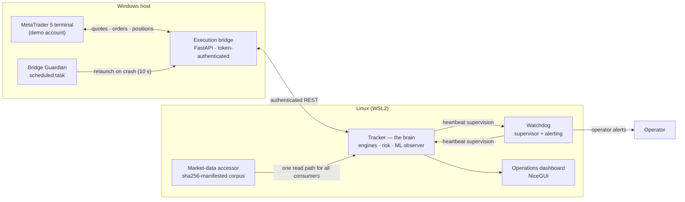
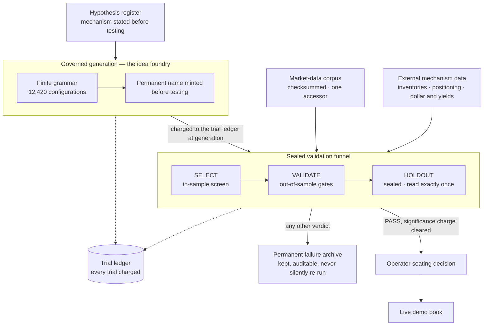

# Architecture

How the system is put together: the components, what each one is allowed to decide, and how the desk recovers when a piece of it fails.

## The shape of the system

Three layers, with a strict rule about who decides what: **the tracker decides, the bridge transports, the terminal executes.** No layer does another layer's job.

## Components

**Tracker (the brain).** A supervised service hosting the strategy engines, the risk layer, and the ML observer. It owns every trading decision: which registered arms are live, what the registry permits, when breakers halt the book. At startup it publishes a machine-readable **book manifest** — every arm loaded, every registry row skipped, and the gate that stopped each skip — so "what is the book right now" is a fact the system states, not something inferred from logs.

**Execution bridge.** A token-authenticated FastAPI service running on the Windows side, translating REST calls into MetaTrader 5 terminal operations: quotes, candles, positions, orders. It decides nothing. Authentication is file-only and fail-closed: the token lives in a single gitignored file, health is verified by a published fingerprint, and a missing or malformed token stops the import rather than letting the bridge run unauthenticated.

**MetaTrader 5 terminal.** The execution venue against a demo account. The bridge is broker-agnostic by design — any MT5 terminal can occupy this seat. The terminal autostarts at operator logon.

**Market-data layer.** One accessor over a stored corpus of 273 files (39 symbols × 7 timeframes — 5-minute through weekly — ~1.3 GB, 2018–present, with five years of 5-minute bars for every symbol), governed by a sha256 checksum manifest. Every consumer — engines, research pipeline, ML assembly — reads through the same door, in the broker's native instrument symbols. The accessor was proven equivalent to the parsers it replaced before cutover: a 148-capture oracle sweep across every served symbol, zero discrepancies, no fallback path kept. The corpus is maintained by a bridge puller with union-merge semantics: a refresh can only ever add bars to a series, never rewrite or shrink it, and the manifest is updated per series as each write lands. An extension adding H2/H3/H6 series for all 39 symbols (390 series total) is in progress, and a separate external-data store — petroleum inventories, Commitments of Traders positioning, dollar-index and Treasury-yield series — is being built under the same raw-plus-normalised, manifest-verified discipline for the mechanism programmes that consume it.

**Timeframe engines.** The tracker hosts one engine per timeframe track. The H1 engine is primary and live; the H4 engine is live. A 15-minute engine is scaffolded with its new-entries gate disabled — it will trade only configurations the protocol certifies. A 5-minute engine is in design: its data layer is already complete (five years of 5-minute bars across all 39 symbols, served through the accessor), and it will ship dark, then run in shadow mode, before any certified seat. All four tracks are inventoried in a declarative **engine registry**, verified mechanically against the code by a checker script. The 4-hour engine carries structured miss-visibility logging — its decision checkpoints emit structured events for evaluated non-entries — after an audit traced a zero-activity window to checkpoints that returned silently. The 15-minute engine's evaluation path is audit-certified; what it lacks is not machinery but provenance, and a sealed re-validation (budgeted, significance-charged) is specified before its gate can open.

**Watchdog.** An independent supervisor classifying the tracker's state from its heartbeat (live, starting, stuck, starved, dead) with criticals that are never cooldown-suppressed. It also runs the **registry-vs-manifest divergence check**: the live book is compared against the registry continuously, and any arm missing without an explained skip raises a critical alert — detection, logging, and alert delivery all proven by live drills, including a deliberately planted phantom row.

**Mutual supervision.** The tracker watches back. A dedicated thread — deliberately not on the trading loop, after a drill showed a loop-bound check could be starved by a blocked call — polls the watchdog's heartbeat and raises (and later clears) its own alert if the watchdog goes stale. Supervision now runs in both directions, and both directions have been drill-tested.

**Bridge Guardian.** A Windows scheduled task that probes the bridge's health endpoint and relaunches it within 10 seconds of a crash, with a crash-loop stop so a broken bridge cannot spin forever. Proven by a live kill drill. It never alerts — alerting is the watchdog's job alone, so a failure produces exactly one voice.

**Dashboard.** A locally served operations UI: positions, equity, per-arm state, breaker status. Local by design; it is an operator's window, not a public surface.

**Idea foundry (research layer).** A governed generation system that mints strategy candidates from a finite grammar of 12,420 configurations, names each one permanently before testing, charges it to the trial ledger at generation, and archives every failure permanently. Its output enters the same sealed SELECT → VALIDATE → HOLDOUT funnel as a hand-written hypothesis; a candidate reaches the book only through a protocol PASS and an operator seating decision. Its first full programme (2,000 candidates, pre-registered, zero holdout budget consumed) completed in October 2026; the second programme's grammar adds risk-profile bundles, three further timeframes, the FX-major universe, external mechanism gates, a candlestick family, and a fenced 5-minute certification block — with generation deduplication and family-coverage quotas enforced mechanically, the first programme's autopsy findings built into the machinery.

## The research pipeline

The desk above is only half the system. The other half decides what is allowed to trade — and it is drawn the same way it runs: every candidate enters at the register, is charged before it is measured, and meets the sealed segment exactly once.

A hand-written hypothesis and a foundry candidate travel the same funnel and pay the same charges — the pipeline does not care where an idea came from, only what it survives. The full protocol is specified in [validation.md](validation.md).

## Failure behaviour

- **A service crashes** → its supervisor restarts it; the book manifest at startup re-states the book; the registry fingerprint in the heartbeat proves the restart did not change what is seated.
- **The bridge dies** → the Guardian relaunches it; the tracker treats transport errors as transport errors (bounded retries, structured logging), never as phantom positions.
- **The host reboots** → Windows auto-restart is disarmed; at logon the terminal autostarts, the Guardian starts the bridge, and the linger-enabled services cold-start — a sequence proven clean after a real Windows-update reboot, with a full unattended logon drill scheduled as the remaining formal proof.
- **Anything unexplained** → the divergence check pages the operator. Explained states are logged; unexplained states are alarms. That asymmetry is the design.
